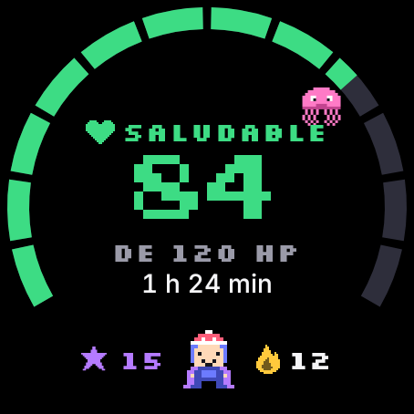
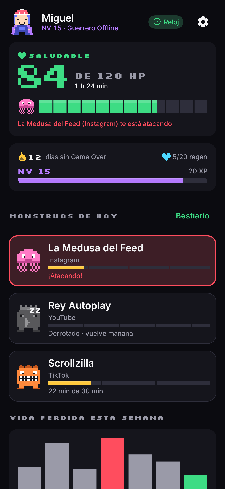
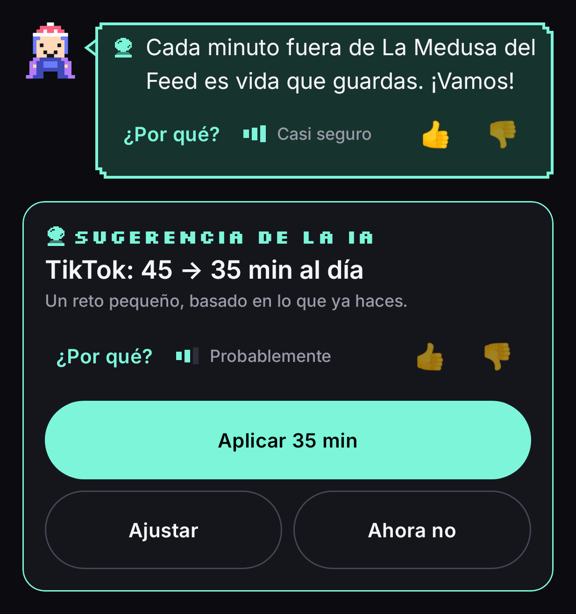
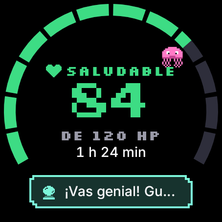
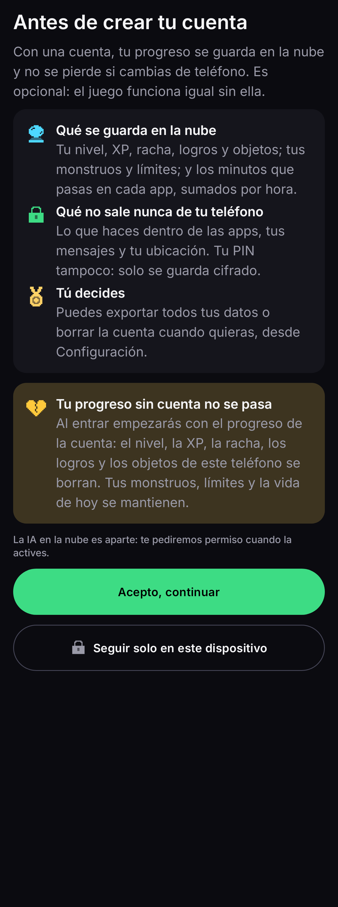
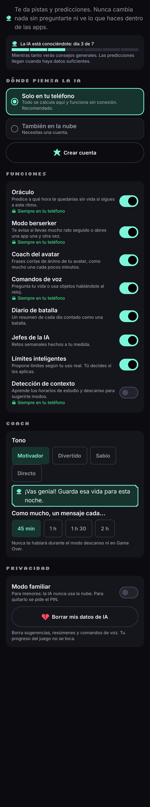

# HP: Health Points

Control de tiempo en pantalla con estética de videojuego, para **Android + Wear OS**.
Tu tiempo diario es una barra de vida (1 HP = 1 minuto); las apps más adictivas son monstruos
con su propio límite; el reloj es el mando. Un compañero de IA da pistas, nunca decide por ti.

| Reloj | Teléfono | IA |
|---|---|---|
|  |  |  |
|  |  |  |

## Qué incluye

- **Juego**: vida diaria, monstruos con límite, bloqueo de apps, pociones/escudos/revivir, logros, rachas,
  historial, avatar, jefe semanal, modo estudio. Funciona sin conexión.
- **Reloj (Wear OS)**: HUD con la barra de vida, monstruos, inventario, alertas, Tile y complicaciones.
  No habla con internet: todo pasa por el teléfono (Wearable Data Layer).
- **Nube (Supabase)**: cuenta con correo o Google, sincronización con cola y reintentos, anti-trampas en
  el servidor (XP, inventario y cierre del día los calcula la base de datos), exportar y borrar la cuenta.
  Sin cuenta, todo se queda en el teléfono ("Solo en este dispositivo").
- **IA (versión simple, por reglas)**: coach del avatar (300 frases, ≥ 45 min entre mensajes), límites
  inteligentes que tú apruebas, Oráculo ("a este ritmo te quedarías sin vida a las 21:40"), aviso berserker,
  diario de batalla y la frase del coach en el reloj. Siempre con "¿Por qué?", certeza en palabras y 👍/👎.

## Módulos

- `shared/`: sistema de diseño (tokens, `HealthBar`, componentes, íconos pixel, componentes de IA), modelos,
  reglas del juego (`GameEngine`), reglas de IA (`ai/rules`) y protocolo reloj ↔ teléfono.
- `wear/`: app de Wear OS (Compose for Wear OS, Material 3).
- `mobile/`: app de teléfono (Compose, Material 3, Hilt, Room, DataStore, WorkManager, supabase-kt).
- `supabase/`: migraciones SQL (tablas, RLS, triggers, funciones RPC, retención) y pruebas de la base.

## Documentación de diseño

1. [Sistema de diseño](docs/01-sistema-de-diseno.md): color con contraste medido, tipografía, forma, movimiento, haptics.
2. [Componente HealthBar](docs/02-health-bar.md): variantes, animaciones y su justificación.
3. [Pantallas y flujos](docs/03-pantallas.md): decisiones por pantalla y principios de usabilidad.
4. [Nube, primera versión](docs/04-supabase.md): *histórico*; la sincronización directa del reloj se sustituyó por la del documento 5.
5. [Arquitectura con Supabase](docs/05-arquitectura-supabase.md): datos, seguridad, sincronización, cuentas y consentimiento.
6. [Módulo de IA](docs/06-modulo-ia.md): arquitectura, tokens visuales y las 5 fases con su justificación.

Capturas: `docs/screenshots/phone` (32) y `docs/screenshots/wear` (28).

## Configurar

Las credenciales van **solo** en `local.properties` (no se sube a git):

```properties
supabase.url=https://xxxx.supabase.co
supabase.key=<anon / publishable key>          # nunca la service_role
google.webClientId=<ID de cliente web>         # opcional: sin él no aparece "Continuar con Google"
release.storeFile=…                            # opcional: firma de release (misma clave para teléfono y reloj)
```

Base de datos: en el SQL Editor de Supabase, pegar `supabase/deploy/hp_schema_v2.sql` y después
`supabase/migrations/006_usage_upsert.sql` y `007_usage_monster_link.sql`. En Authentication → URL Configuration, añadir la redirección
`hpdesconecta://auth/**`. Sin `supabase.url` la app funciona igual, solo en el dispositivo.

## Compilar y probar

```bash
./gradlew :shared:testDebugUnitTest            # 62 pruebas: reglas del juego y de la IA
./gradlew :wear:assembleDebug :mobile:assembleDebug
./gradlew :wear:recordRoborazziDebug :mobile:recordRoborazziDebug   # regenera las capturas
./gradlew :mobile:testDebugUnitTest --tests "*RemoteGameApiIntegrationTest" -Dhp.integration=true   # contra Supabase real
```

Ambas apps usan el mismo `applicationId` (`com.desconecta.hp`), requisito de la Wearable Data Layer API.
Instala `mobile` en el teléfono y `wear` en el reloj. Para que se vean entre sí, el teléfono necesita la app
**Wear OS** y estar emparejado con el reloj; sin emparejar, el reloj ofrece "Probar demo".

## Limitaciones conocidas

- La IA es por reglas (sin modelo en el dispositivo ni en la nube); la función de nube quedó como trabajo futuro.
- Sin comandos de voz.
- Probado en emuladores y con pruebas automáticas; conviene usarla varios días en un teléfono real
  (los límites inteligentes necesitan 7 días de datos).
