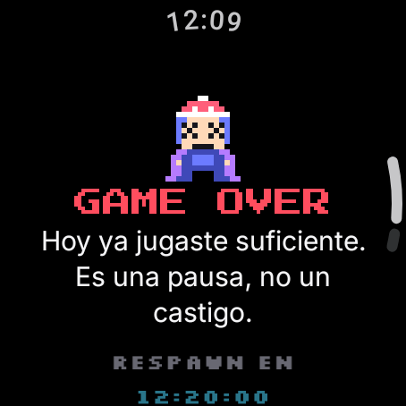
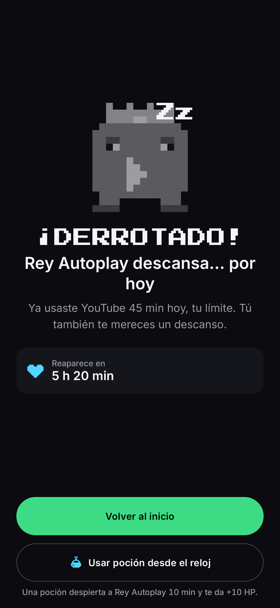

# HP: Health Points

Control de tiempo en pantalla con estética de videojuego, para **Android + Wear OS**.
Tu tiempo diario es una barra de vida (1 HP = 1 minuto); las apps más adictivas son monstruos
con su propio límite; el reloj es el mando.

| Reloj | Teléfono |
|---|---|
|  |  |
|  |  |

## Módulos

- `shared/`: sistema de diseño (tokens, `HealthBar`, componentes, íconos pixel), modelos, reglas (`GameEngine`) y protocolo reloj ↔ teléfono.
- `wear/`: app de Wear OS (Compose for Wear OS, Material 3): HUD, monstruos, inventario, alertas, Tile y complicaciones.
- `mobile/`: app de teléfono (Compose, Material 3, Hilt, Room, DataStore, WorkManager): monitoreo, bloqueo y todas las pantallas.

## Documentación de diseño

1. [Sistema de diseño](docs/01-sistema-de-diseno.md): color con contraste medido, tipografía, forma, movimiento, haptics.
2. [Componente HealthBar](docs/02-health-bar.md): variantes, animaciones y su justificación.
3. [Pantallas y flujos](docs/03-pantallas.md): decisiones por pantalla y principios de usabilidad.
4. [Nube con Supabase](docs/04-supabase.md): respaldo y sincronización del reloj por Wi‑Fi.

## Compilar y probar

```bash
./gradlew :shared:testDebugUnitTest            # 17 pruebas de las reglas
./gradlew :wear:assembleDebug :mobile:assembleDebug
./gradlew :wear:recordRoborazziDebug :mobile:recordRoborazziDebug   # regenera las capturas
```

Ambas apps usan el mismo `applicationId` (`com.desconecta.hp`), que es un requisito de la Wearable Data Layer API.
Instala `mobile` en el teléfono y `wear` en el reloj (o en el emulador de Wear OS emparejado).
